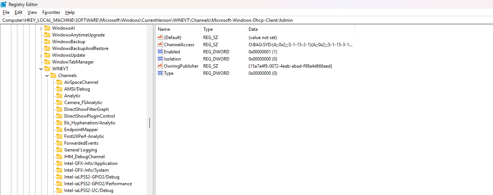
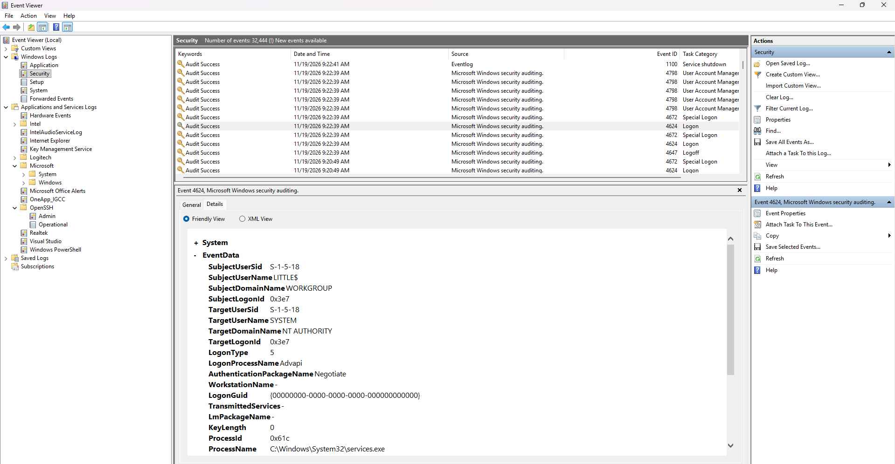
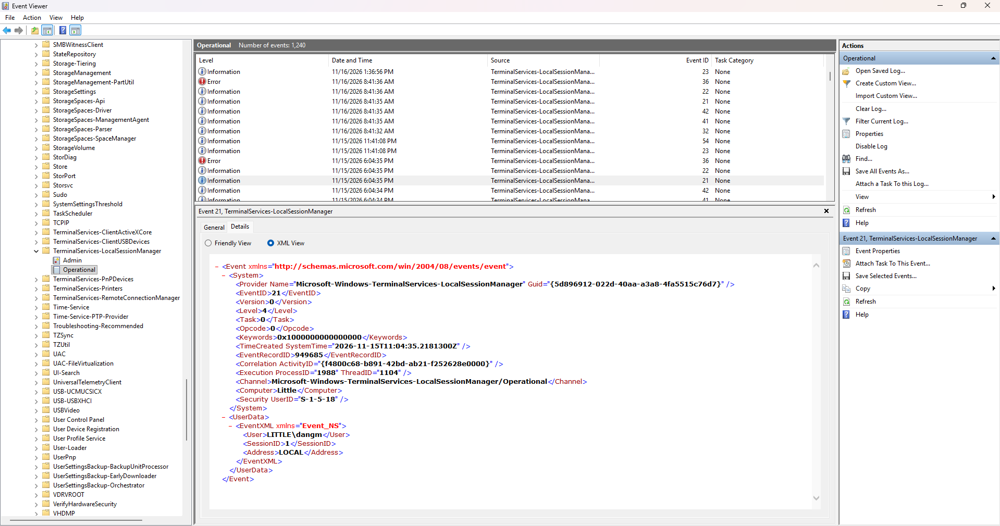

> Trong Cybersecurity Operations, quan sát là một kĩ năng cực kì quan trong. Các **Security Operations Centers (SOC)** dựa vào **logs** để phát hiện các mối đe dọa, điều tra sự cố và hiểu những gì đang xảy ra trong hệ thống. Nếu không có logs, SOC sẽ mất đi khả năng truy vết hoạt động của các attacker, rất khó để xác thực các hành vi đáng ngờ hoặc tái tạo lại các sự kiện sau khi sự cố xảy ra.

> Hiện nay, Windows Server được sử dụng rộng trong môi trường doanh nghiệp trên toàn thế giới, điều đó khiến cho **Windows Event Logs** trở thành nguồn dữ liệu quan trọng cho các nhà phân tích SOC. Các logs này ghi lại các hành vi như: *user login, process excution, system event ,...*. Blog này mình sẽ tập trung vào các kiến thức foundation để hiểu rõ hơn về Windows Logs, bắt đầu với khái niệm về logs và tại sao chúng đóng vai trò cực kì quan trọng trong điều tra số.


## What is logs ?

**Logs**, nói một cách đơn giản, là các thông tin lịch sử hoặc một cuốn sách kỹ thuật số ghi lại những gì xảy ra trên một hệ thống. Mọi thứ từ đăng nhập người dùng đến mở ứng dụng đều được ghi lại dưới dạng logs.

Hiểu về logs rất quan trọng đối với hầu hết các vai trò phòng thủ trong an ninh mạng. Khi một cuộc tấn công xảy ra, logs giúp các điều tra viên trả lời các câu hỏi quan trọng như:

- Chuyện gì đã xảy ra ?
- Chuyện đó xảy ra khi nào ?
- Chuyện đó xảy ra ở đâu ?
- Chuyện đó xảy ra như thế nào ?
- Attacker có thành công trong việc lấy dữ liệu hoặc làm hỏng hệ thống không ?
- Nếu có, tác động là gì ?

Bằng cách liên kết các logs lại với nhau, ta có thể recover lại luồng tấn công của attacker và xác định chuỗi tấn công đó, từ lần access đầu tiên đến tác động cuối cùng.

## Where are the Windows event logs located?

### Định dạng và thư mục lưu trữ

Từ Windows Vista và Server 2008 trở đi, Windows ghi log dưới dạng `.evtx` (nhị phân, cấu trúc XML bên trong), do dịch vụ **Windows Event Log** quản lý. Mặc định tất cả file nằm trong đường dẫn `C:\Windows\System32\winevt\Logs\`.


Mỗi **channel log** là một file `.evtx`. Với kênh có dấu `/` trong tên,  Windows đổi `/` thành `%4` khi đặt tên file. Ví dụ:

```
Microsoft-Windows-PowerShell/Operational -> Microsoft-Windows-PowerShell%4Operational.evtx
Microsoft-Windows-Sysmon/Operational -> Microsoft-Windows-Sysmon%4Operational.evtx
```

### Các nhóm log chính

**Windows Logs (5 kênh cốt lõi):**

| Kênh | File | Chứa gì | Ví dụ |
|---|---|---|---|
| **Security** | `Security.evtx` | Sự kiện bảo mật theo audit policy: đăng nhập, quyền, tạo tài khoản, truy cập đối tượng | 4624, 4625, 4672, 4688, 1102 |
| **System** | `System.evtx` | Sự kiện của hệ điều hành, driver, service | 7045 (service mới), 7036, 104 |
| **Application** | `Application.evtx` | Sự kiện do ứng dụng ghi | Lỗi ứng dụng, cảnh báo Defender (một phần) |
| **Setup** | `Setup.evtx` | Cài đặt, cập nhật, hotfix | Cập nhật Windows |
| **Forwarded Events** | `ForwardedEvents.evtx` | Log nhận từ máy khác (qua Windows Event Forwarding) | Dùng khi gom log tập trung |

**Lưu ý nhỏ**: cơ chế gom log có sẵn của Windows là **Windows Event Forwarding (WEF)**, nơi máy thu (collector) nhận log vào kênh Forwarded Events.

**Applications and Services Logs:** log riêng cho từng thành phần, thường sẽ chi tiết hơn các kênh cốt lõi. Mỗi thành phần chia thành các loại:
- **Admin:** dành cho quản trị viên, thường chứa lỗi và cảnh báo.
- **Operational:** ghi hoạt động vận hành bình thường. Đây là loại SOC quan tâm nhất.
- **Analytic/Debug:** rất nhiều dữ liệu, mặc định tắt và ẩn (muốn thấy phải bật "Show Analytics and Debug Logs" trong Event Viewer)

Một số kênh cần biết khi điều tra:
| Kênh | Dùng để |
|---|---|
| `Microsoft-Windows-PowerShell/Operational` | Script block logging (4104) |
| `Microsoft-Windows-Sysmon/Operational` | Log Sysmon (nếu đã cài) |
| `Microsoft-Windows-TaskScheduler/Operational` | Tạo, chạy scheduled task |
| `Microsoft-Windows-TerminalServices-RemoteConnectionManager/Operational` và `LocalSessionManager` | Phiên RDP |
| `Microsoft-Windows-Windows Defender/Operational` | Phát hiện và xử lý malware |
| `Microsoft-Windows-WinRM/Operational` | Remote qua WinRM/PowerShell Remoting |


Sử dụng **Event Viewer** để xem logs:


Mỗi kênh đều có giới hạn dung lượng (các kênh Windows Logs thường khoảng **20MB** mặc định, có thể thay đổi). Khi đầy, Windows mặc định **ghi đè các sự kiện cũ nhất**.

### Vị trí và cấu hình trong Registry

Vị trí file, dung lượng tối đa và chính sách giữ log của từng kênh được khai báo trong Registry tại `HKLM\SYSTEM\CurrentControlSet\Services\EventLog\<Tên kênh>`:


**Lưu ý:** quản trị viên (hoặc attacker có quyền cao) có thể thay đổi đường dẫn hoặc giảm dung lượng, nên khi điều tra đừng giả định rằng log luôn nằm ở thư mục mặc định.

### Những nơi lưu dấu vết khác (ngoài Event Log)

Không phải mọi thứ đều nằm trong `.evtx`. Một số nguồn bổ trợ:

| Nguồn | Vị trí | Dùng để |
|---|---|---|
| Log web IIS | `C:\inetpub\logs\LogFiles\` | Truy vết tấn công web |
| Prefetch | `C:\Windows\Prefetch\` | Bằng chứng chương trình đã chạy |
| Log cài đặt driver | `C:\Windows\INF\setupapi.dev.log` | Thiết bị USB, driver |
| Log ETW (`.etl`) | Tùy thành phần | Theo dõi sâu cấp hệ thống |
| PowerShell transcript | Do cấu hình chỉ định | Ghi lại phiên PowerShell |
| Log ứng dụng riêng | Thư mục của ứng dụng | Trình duyệt, phần mềm bên thứ ba |

## Event and Registry

**Event** cho ta biết chuyện gì đã xảy ra. **Registry** cho ta biết hệ thống đang được cấu hình như thế nào. Attacker thường để lại dấu vết ở cả 2 nơi. Biết đối chiếu cả 2 thì ta sẽ khó bị attacker đánh lừa nếu một bên bị xóa dấu vết.

Nhắc lại một chút về **Registry**: là một cơ sở dữ liệu cấu hình của Windows (OS, service, software, users). Các dữ liệu được tổ chức thành **key (thư mục)** và **value (file)**. Hai hive chủ yếu gặp khi điều tra:
- `HKLM (HKEY_LOCAL_MACHINE)`: cấu hình của toàn máy.
- `HKCU (HKEY_CURRENT_USER)`: cấu hình riêng của người dùng đang đăng nhập.

Ở phần 1 mình đã nhắc về vị trí file log được khai báo trong Registry. Ở đây nói rõ hơn:
| Key | Chứa gì |
|---|---|
| `HKLM\SYSTEM\CurrentControlSet\Services\EventLog\<Kênh>` | `File` (đường dẫn), `MaxSize`, `Retention` |
| `HKLM\SOFTWARE\Microsoft\Windows\CurrentVersion\WINEVT\Channels\<Kênh>` | Trạng thái bật/tắt của kênh (Enabled) và nhà cung cấp sở hữu kênh |
| `HKLM\SOFTWARE\Microsoft\Windows\CurrentVersion\WINEVT\Publishers\<GUID>` | Thông tin nhà cung cấp (provider), file chứa thông điệp để hiển thị event |

Xem trong **Registry Editor**:


**Góc nhìn của SOC**: Attacker có thể giảm `MaxSize`, đổi đường dẫn hoặc tắt kênh để giảm dấu vết. Vì vậy, các key này nên được giám sát cẩn thận. Các event gốc giúp phát hiện việc này:
| Event ID | Log | Ý nghĩa |
|---|---|---|
| **1102** | Security | Security log bị xóa |
| **104** | System | Một log khác bị xóa |
| **1100** | Security | Dịch vụ Event Log bị tắt |
| **4719** | Security | Audit policy bị thay đổi |

### Mối quan hệ giữa Event và Registry

**Chiều 1: Event ghi lại việc Registry bị thay đổi**

| Event ID | Ý nghĩa |
|---|---|
| **4657** | Một giá trị registry được tạo, sửa hoặc xóa |
| **4656** | Có yêu cầu mở handle tới key/value (ai đó chuẩn bị truy cập) |
| **4663** | Có truy cập vào đối tượng (ghi, xóa...) |
| **4660** | Đối tượng bị xóa (dùng để thấy key bị xóa) |

Điều kiện cần để các event này xuất hiện:
1. Bật audit subcategory **Registry** (thuộc Object Access).
2. Đặt **SACL** (danh sách kiểm toán) trên đúng key cần theo dõ. Không có SACL thì không có event.

Vì vậy cách làm thực tế là chỉ theo dõi một số key quan trọng như `Run`, `Services` chứ không theo dõi toàn bộ Registry, nếu không log sẽ tràn ngập.

Ví dụ, các trường của 4657 cần giải thích:
| Trường | Ý nghĩa |
|---|---|
| `ObjectName` | Key bị thay đổi (dạng `\REGISTRY\MACHINE\...`) |
| `ObjectValueName` | Tên value |
| `OperationType` | Tạo mới, sửa hay xóa value |
| `OldValue`, `NewValue` | Giá trị trước và sau khi đổi |
| `ProcessName` | Process thực hiện thay đổi |
| `SubjectUserName`, `SubjectLogonId` | Tài khoản và phiên thực hiện |


**Chiều 2: Hành động của hệ thống sinh event và tạo thay đổi registry**

| Hành động | Event | Dấu vết trong Registry |
|---|---|---|
| Cài service mới | System 7045; Security 4697 (nếu bật audit) | `HKLM\SYSTEM\CurrentControlSet\Services\<tên>` (`ImagePath`, `Start`) |
| Đổi kiểu khởi động service | System 7040 | Giá trị `Start` của service |
| Tạo / xóa / sửa scheduled task | Security 4698 / 4699 / 4702 | `HKLM\SOFTWARE\Microsoft\Windows NT\CurrentVersion\Schedule\TaskCache\...` |
| Chạy lệnh `reg.exe` | Security 4688 (nếu bật ghi command line) | Đọc ngay lệnh `reg add ...` để biết ai sửa gì |

Ví dụ event ID 4688:


### Các key persistence cần biết

| Vị trí | Ý nghĩa |
|---|---|
| `HKCU\Software\Microsoft\Windows\CurrentVersion\Run` và `HKLM\SOFTWARE\Microsoft\Windows\CurrentVersion\Run` | Chạy chương trình mỗi lần đăng nhập |
| `HKCU\Software\Microsoft\Windows\CurrentVersion\RunOnce` và `HKLM\SOFTWARE\Microsoft\Windows\CurrentVersion\RunOnce` | Chạy một lần rồi xóa |
| `HKLM\SOFTWARE\Microsoft\Windows NT\CurrentVersion\Winlogon` (`Shell`, `Userinit`) | Bị lạm dụng để chèn chương trình khi đăng nhập |
| `HKLM\SOFTWARE\Microsoft\Windows NT\CurrentVersion\Image File Execution Options\<exe>` (`Debugger`) | Gắn "debugger" để chạy thay cho EXE gốc |
| `HKLM\SYSTEM\CurrentControlSet\Services\<TênService>` | Service độc hại |

Có thể đối chiếu MITRE ATT&CK: T1547 (Boot or Logon Autostart Execution), T1543 (Create or Modify System Process), T1053 (Scheduled Task).

## Cấu trúc một event

Mọi event Windows đều có cùng một khung. Hiểu được khung này thì sẽ dễ dàng đọc được mọi loại event, bất kể Event ID là gì.

Mở một event bất kỳ (ví dụ 4624 trong Security) sẽ thấy 2 tab:
- **General**: mô tả dạng văn bản dễ đọc, được Windows ghép từ dữ liệu và mẫu thông điệp.

- **Details**: dữ liệu gốc, có 2 chế độ là *Friendly View* và *XML View*.


Khung XML của một event gồm 2 khối lớn: `<System>` (thông tin chung, giống nhau ở mọi event) và `<EventData>` (dữ liệu riêng, khác nhau theo từng Event ID).
```xml
- <Event xmlns="http://schemas.microsoft.com/win/2004/08/events/event">
- <System>
  <Provider Name="Microsoft-Windows-Security-Auditing" Guid="{54849625-5478-4994-a5ba-3e3b0328c30d}" />
  <EventID>4624</EventID>
  <Version>3</Version>
  <Level>0</Level>
  <Task>12544</Task>
  <Opcode>0</Opcode>
  <Keywords>0x8020000000000000</Keywords>
  <TimeCreated SystemTime="2026-11-19T02:22:39.9019565Z" />
  <EventRecordID>4160836</EventRecordID>
  <Correlation ActivityID="{86bc5aa3-77c0-0002-325f-bc86c077dd01}" />
  <Execution ProcessID="1592" ThreadID="2972" />
  <Channel>Security</Channel>
  <Computer>Little</Computer>
  <Security />
  </System>
- <EventData>
  <Data Name="SubjectUserSid">S-1-5-18</Data>
  <Data Name="SubjectUserName">LITTLE$</Data>
  <Data Name="SubjectDomainName">WORKGROUP</Data>
  <Data Name="SubjectLogonId">0x3e7</Data>
  <Data Name="TargetUserSid">S-1-5-18</Data>
  <Data Name="TargetUserName">SYSTEM</Data>
  <Data Name="TargetDomainName">NT AUTHORITY</Data>
  <Data Name="TargetLogonId">0x3e7</Data>
  <Data Name="LogonType">5</Data>
  <Data Name="LogonProcessName">Advapi</Data>
  <Data Name="AuthenticationPackageName">Negotiate</Data>
  <Data Name="WorkstationName">-</Data>
  <Data Name="LogonGuid">{00000000-0000-0000-0000-000000000000}</Data>
  <Data Name="TransmittedServices">-</Data>
  <Data Name="LmPackageName">-</Data>
  <Data Name="KeyLength">0</Data>
  <Data Name="ProcessId">0x61c</Data>
  <Data Name="ProcessName">C:\Windows\System32\services.exe</Data>
  <Data Name="IpAddress">-</Data>
  <Data Name="IpPort">-</Data>
  <Data Name="ImpersonationLevel">%%1833</Data>
  <Data Name="RestrictedAdminMode">-</Data>
  <Data Name="RemoteCredentialGuard">-</Data>
  <Data Name="TargetOutboundUserName">-</Data>
  <Data Name="TargetOutboundDomainName">-</Data>
  <Data Name="VirtualAccount">%%1843</Data>
  <Data Name="TargetLinkedLogonId">0x0</Data>
  <Data Name="ElevatedToken">%%1842</Data>
  </EventData>
  </Event>
```

**Khối `<System>`**:
| Trường | Ý nghĩa | Dùng để làm gì |
|---|---|---|
| `Provider Name` | Thành phần sinh ra event | Phân biệt nguồn, vì cùng Event ID khác Provider là khác nghĩa |
| `EventID` | Mã loại sự kiện | Lọc event |
| `Version` | Phiên bản định dạng của event | Cùng ID nhưng khác version có thể khác trường dữ liệu |
| `Level` | Mức độ nghiêm trọng | Critical/Error/Warning/Information/Verbose |
| `Keywords` | Nhóm từ khóa | Với Security: audit thành công hay thất bại |
| `TimeCreated` | Thời điểm ghi | Dựng timeline  |
| `EventRecordID` | Số thứ tự bản ghi trong log | Sắp xếp và phát hiện khoảng trống  |
| `Channel` | Kênh log chứa event | Biết event nằm ở log nào |
| `Computer` | Máy sinh event | Quan trọng khi gom log nhiều máy |
| `Execution` | Process/thread ghi event | Ít dùng, nhưng hữu ích khi truy vết |

**Lưu ý với Security log**: event Security thường có `Level = 0` (LogAlways). Mức “thành công hay thất bại” nằm ở Keywords: Audit Success (`0x8020000000000000`) hoặc Audit Failure (`0x8010000000000000`). Ví dụ `4624` là Success, `4625` là Failure.

**Khối `<EventData`>**:

Phần này khác nhau theo từng Event ID. Lấy `4624` (đăng nhập thành công) làm ví dụ:
| Nhóm | Trường | Ý nghĩa |
|---|---|---|
| Subject (ai yêu cầu đăng nhập) | `SubjectUserName`, `SubjectDomainName`, `SubjectLogonId` | Thường là chính máy (`WIN-LAB01$`) hoặc `SYSTEM`, vì tiến trình hệ thống thay mặt người dùng thực hiện |
| Target (tài khoản được đăng nhập) | `TargetUserName`, `TargetDomainName`, `TargetLogonId` | Tài khoản thực sự đăng nhập, `TargetLogonId` dùng để nối phiên |
| Cách đăng nhập | `LogonType`, `LogonProcessName`, `AuthenticationPackageName` | Loại đăng nhập (RDP, mạng, console...), cơ chế xác thực (NTLM, Kerberos) |
| Nguồn kết nối | `IpAddress`, `IpPort`, `WorkstationName` | Máy và IP phát sinh kết nối |
| Tiến trình | `ProcessName`, `ProcessId` | Tiến trình xử lý đăng nhập |

**Lưu ý:** nhiều người đọc nhầm trường `Subject` là người dùng đăng nhập. Thực tế tài khoản đăng nhập nằm ở `Target`. Với đăng nhập từ xa, `Subject` thường chỉ là tài khoản máy.

## Event ID quan trọng và Logon Type

Windows có hàng nghìn Event ID, nhưng SOC chỉ cần nắm những ID quan trọng để đọc được phần lớn sự cố. Phần này mình sẽ chia theo nhóm hành vi thay vì liệt kê theo số.

**Lưu ý:** những event có dấu **(*)** là cần phải bật audit mới có.

### Đăng nhập và xác thực (Log Security)

| Event ID | Ý nghĩa | Dấu hiệu đáng ngờ |
|---|---|---|
| **4624** | Đăng nhập thành công | Logon Type lạ (3, 10), giờ bất thường, IP nguồn lạ |
| **4625** | Đăng nhập thất bại | Nhiều lần từ cùng IP, hoặc nhiều tài khoản khác nhau |
| **4634** | Phiên đăng nhập kết thúc | Dùng để tính thời lượng phiên |
| **4647** | Người dùng chủ động đăng xuất | Bổ sung cho 4634 (4634 không phải lúc nào cũng được ghi) |
| **4648** | Đăng nhập bằng thông tin xác thực tường minh | Dùng `runas`, `net use` với user khác, dấu hiệu di chuyển ngang |
| **4672** | Phiên đăng nhập được gán đặc quyền cao | Tài khoản lạ có quyền admin |
| **4740** | Tài khoản bị khóa | Xuất hiện sau chuỗi 4625 |

**Mở rộng cho Domain Controller**: 4768 (xin TGT Kerberos), 4769 (xin service ticket), 4771 (Kerberos pre-auth thất bại), 4776 (xác thực NTLM).

### Quản lý tài khoản và nhóm (Log Security)

| Event ID | Ý nghĩa | Dấu hiệu đáng ngờ |
|---|---|---|
| **4720** | Tạo tài khoản | Tài khoản mới ngoài giờ hoặc không có yêu cầu |
| **4722 / 4725** | Bật / vô hiệu hóa tài khoản | Bật lại tài khoản cũ đã khóa |
| **4726** | Xóa tài khoản | Xóa để che dấu vết |
| **4732** | Thêm thành viên vào nhóm cục bộ | Thêm vào Administrators ngay sau 4720 |

### Excution and Persistence

| Event ID | Log | Ý nghĩa | Dấu hiệu đáng ngờ |
|---|---|---|---|
| **4688 (*)** | Security | Tạo process mới | Process lạ, parent bất thường (ví dụ `winword.exe` sinh ra `cmd.exe` / `powershell.exe`), command line đáng ngờ |
| **7045** | System | Cài service mới | `ImagePath` trỏ vào Temp, AppData, đường dẫn lạ |
| **4697 (*)** | Security | Cài service (bản ghi từ phía Security) | Như 7045 |
| **4698 (*)** | Security | Tạo scheduled task | Task chạy script hoặc file lạ |
| **4699 / 4702 (*)** | Security | Xóa / sửa task | Sửa task có sẵn để chèn lệnh |

### Powershell

| Event ID | Log | Ý nghĩa | Dấu hiệu đáng ngờ |
|---|---|---|---|
| **4104 (*)** | PowerShell/Operational | Nội dung script block đã chạy | Lệnh mã hóa Base64, `Invoke-Expression`, `DownloadString`, mã bị làm rối |
| **4103 (*)** | PowerShell/Operational | Ghi pipeline (module logging) | Cmdlet lạ |

### Truy cập tài nguyên mạng

| Event ID | Ý nghĩa | Dấu hiệu đáng ngờ |
|---|---|---|
| **5140 (*)** | Truy cập một network share | Truy cập `ADMIN$`, `C$`, `IPC$` từ máy lạ |
| **5145 (*)** | Kiểm tra chi tiết quyền trên file share | Truy cập file lạ qua SMB |

### Che dấu vết

| Event ID | Log | Ý nghĩa |
|---|---|---|
| **1102** | Security | Security log bị xóa |
| **104** | System | Một log khác bị xóa |
| **1100** | Security | Dịch vụ Event Log bị tắt |
| **4719** | Security | Audit policy bị thay đổi |

**Lưu ý:** các event này hầu như không bao giờ xuất hiện trong hoạt động bình thường, có dấu hiệu là phải điều tra ngay.

### Log chuyên nghiệp cho RDP và Defender (ngoài Security)

Các kênh **Applications and Services Logs** có những event rất tiện:
| Kênh | Event ID | Ý nghĩa |
|---|---|---|
| `TerminalServices-RemoteConnectionManager/Operational` | **1149** | Xác thực RDP thành công (trước khi tạo phiên) |
| `TerminalServices-LocalSessionManager/Operational` | **21 / 22 / 23 / 24 / 25** | Đăng nhập phiên / khởi động shell / đăng xuất / ngắt kết nối / kết nối lại |
| `Windows Defender/Operational` | **1116 / 1117 / 5001** | Phát hiện mã độc / đã xử lý / tắt bảo vệ thời gian thực |

Ví dụ mở `TerminalServices-LocalSessionManager/Operational`:


### Logon Type

Trường **LogonType** trong `4624/4625` cho biết cách đăng nhập, rất quan trọng khi xác định nguồn của một cuộc tấn công.
| Type | Tên | Ý nghĩa | Ghi chú SOC |
|---|---|---|---|
| **2** | Interactive | Đăng nhập tại máy (bàn phím) | Bình thường với người dùng tại chỗ |
| **3** | Network | Truy cập qua mạng (SMB, chia sẻ file, thực thi từ xa) | **Hay gặp trong tấn công từ xa** |
| **4** | Batch | Scheduled task | Task lạ chạy bằng tài khoản người dùng |
| **5** | Service | Service khởi động | Service lạ dùng tài khoản đặc quyền |
| **7** | Unlock | Mở khóa màn hình, hoặc kết nối lại phiên RDP | |
| **8** | NetworkCleartext | Mật khẩu gửi dạng rõ | Hiếm, đáng ngờ |
| **9** | NewCredentials | Dùng `runas /netonly` | Dùng thông tin khác cho kết nối mạng |
| **10** | RemoteInteractive | Remote Desktop (RDP) | **Cần chú ý nhất khi bị truy cập từ xa** |
| **11** | CachedInteractive | Dùng thông tin đã cache khi không liên lạc được DC | Máy ngoài mạng công ty |
| **12 / 13** | CachedRemoteInteractive / CachedUnlock | Biến thể cache cho RDP và mở khóa | |

**Lưu ý:** khi máy bật **NLA (Network Level Authentication)**, mặc định ở Windows hiện đại, việc xác thực RDP diễn ra trước khi tạo phiên. Hệ quả:
- Đăng nhập RPD thất bại thường ghi `4625` với Logon Type `3` (không phải `10`).
- Đăng nhập RDP thành công thường thấy một `4624` Type `3` (xác thực NLA), sau đó một `4624` Type `10` (tạo phiên).
- Kết nối lại phiên RDP cũ thường ghi Type `7`.